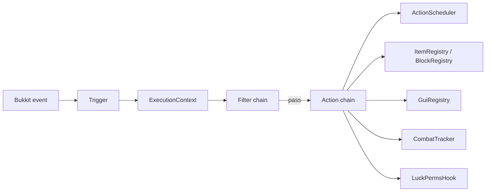

# 🏛️ ActionsAndTriggers (AAT) Core Architecture

## 1. Mission and stack

**ActionsAndTriggers (AAT)** is a Paper/Purpur plugin that turns Bukkit events into declarative pipelines (trigger → filters → actions) and adds a widget-based inventory GUI engine with a scheduler, cooldowns and combat tagging.

- Java 21, Gradle multi-module build.
- Compiled against `io.papermc.paper:paper-api:1.21.4-R0.1-SNAPSHOT` (`paperVersion` Gradle property, default 1.21.4). Release artifacts are built against the minimum supported API; a compile matrix also checks 1.21.5, 1.21.8 and 1.21.11.
- Pure Bukkit/Paper API, no NMS.
- Optional soft dependencies: Oraxen, ItemsAdder, PlaceholderAPI, LuckPerms.

## 2. Module layout

| Module | Contents |
| :--- | :--- |
| `:aat-api` | Public contracts (`Action`, `Filter`, `Trigger`), registries, `ActionTriggerAPI`, `ExecutionContext`/`CoreKeys`, `ActionScheduler`, `Registrar`, GUI classes and widgets, provider interfaces, `PapiHook`. |
| `:aat-core` | Plugin entry point `ActionsTriggers`, `AATParser`, `YamlTriggerLoader`, `YamlGuiLoader`, `GuiRegistry`/`GuiListener`, default actions/filters/triggers, `I18n`, `CombatTracker`, hooks, Lamp commands. Also contains `api.parser` and `api.provider.impl` packages (parser and Oraxen/ItemsAdder providers), so the API jar is not a complete standalone toolkit. |

Build outputs: `apiJar` (thin API jar) and `shadowJar` (shaded plugin, Lamp relocated to `kostin.ak.actionstriggers.libs.revxrsal`). `deployToPlugins` copies the shaded jar into a hard-coded local server directory and is part of the root `build` task.

## 3. Runtime pipeline

1. `ActionsTriggers#onEnable` creates the registries and the scheduler, calls `ActionTriggerAPI#init`, registers default actions, filters and triggers, initialises hooks and commands, then loads `triggers/` and `guis/`.
2. A Bukkit event listener derived from `BukkitEventTrigger` performs a fast-exit check (`TriggerRegistry#hasSubscriptions`) and only then builds an `ExecutionContext` from the declared `ContextKey` extractors.
3. `TriggerRegistry#dispatch` runs global debug listeners, then each subscription whose filter passes.
4. `YamlTriggerLoader` builds one callback per script entry that executes the parsed actions in order and stops when the context is cancelled.
5. `BukkitEventTrigger` cancels the underlying event if the context was cancelled and the event is `Cancellable`.

## 4. Execution context

`ExecutionContext` is a `ConcurrentHashMap`-backed bag of typed values with a `cancelled` flag.

- Keys are `ContextKey<T>` instances compared by `id` + `type`; reading with the wrong type returns `null`.
- `CoreKeys` defines the shared keys: `PLAYER`, `LOCATION`, `BLOCK`, `BLOCK_MATERIAL`, `ENTITY`, `ITEM`, `ITEM_IN_HAND`, `ITEM_IN_HAND_ID`, `ITEM_ID`, `BLOCK_ID`, `CLICKED_BLOCK_ID`, `MESSAGE`, `DAMAGE`, `DAMAGE_CAUSE`, `DAMAGER`, `DAMAGE_SOURCE`, `ITEM_DROPS`, `KILLER`, `LEVEL`, `WORLD`, `WORLD_NAME`, `FROM_WORLD`, `TO_WORLD`, `HAS_BLOCK`, `IS_FLYING`, `ADVANCEMENT_KEY`, `ACTION`, `BUTTON_TYPE`.
- `clone()` produces an independent copy, which the scheduler uses for delayed and repeating work.
- The exact keys each trigger provides are listed in `docs/en/TRIGGERS_AND_ACTIONS.md`. There is no `CANCEL_CONSUMER`: cancellation is the `cancelled` flag.

## 5. Subsystems

### 5.1. Actions, filters and parsing

- `ActionRegistry` and `FilterRegistry` scan classes for `@ConfigAction` / `@ConfigFilter` static factories and cache `@ActionParam` metadata for `/aat list` and `/aat get params`.
- `AATParser` (in `:aat-core`) parses single actions, lists of actions, conditions, `inject_context` blocks and whole trigger definitions. `ParserOptions` defines the accepted keys (`action`/`action_type`/`id`, `type`/`condition`/`id`, `trigger`/`event`/`type`, `inject_context`).
- Unknown action or filter IDs throw `IllegalArgumentException` during loading; the loader logs the file and continues with the next trigger.

### 5.2. Scheduler and cooldowns

`ActionScheduler` wraps the Bukkit scheduler: `runLater`, `runRepeating` (iteration counter in `{iteration}`), `runRepeatingTask`, named `scheduleNamed`/`cancelNamed`, and per-player cooldowns keyed by `UUID + key`.

All of it is in-memory. Named tasks and cooldowns are lost on restart; `cancelAll()` is available but the plugin does not call it in `onDisable` (it calls `Bukkit.getScheduler().cancelTasks(plugin)`).

### 5.3. Combat tracker

`CombatTracker` stores an expiry timestamp per player. `CombatListener` tags attackers and victims on `EntityDamageByEntityEvent` and any player damage on `EntityDamageEvent`, in survival/adventure only, with a fixed 15-second duration.

`config.yml` contains `combat.duration_seconds` and `combat.close_gui_on_damage`, but neither value is read anywhere: the duration is the constructor default 15, and damage only force-closes a GUI whose id is exactly `astral_atlas` (hard-coded in `CombatListener#checkAndCloseAtlas`).

### 5.4. Item and block providers

`ItemRegistry` and `BlockRegistry` resolve `<namespace>:<id>` strings. Vanilla items are always registered; Oraxen and ItemsAdder providers are registered conditionally in `onEnable`.

There is **no vanilla `BlockProvider`**. `BlockRegistry#getFullId` falls back to `minecraft:<lowercase material name>`, so vanilla block IDs still resolve, but `BlockRegistry#placeBlock` cannot place vanilla blocks through a provider.

### 5.5. GUI engine

`GuiRegistry` owns GUI definitions by id, opens inventories backed by `AATGuiHolder`, renders widgets into a slot matrix and re-renders on refresh. `GuiListener` cancels clicks/drags on non-widget slots and returns items from input/output slots on `InventoryCloseEvent`. Details and limitations: `docs/en/GUI_ENGINE.md`.

### 5.6. Localization

`I18n` loads `lang/messages_<language>.yml` into a `ConcurrentHashMap`, supports `{param}` interpolation and caches `Component`s. The active language comes from `config.yml` `language`.

Localization covers loader logs, combat messages and the built-in machine messages. Many command replies, tab-completion hints, machine status strings and action defaults are hard-coded Russian/English text in `ActionCommand`, `AATTabCompleter`, `DefaultActionParsers` and `ProgressBarWidget`.

### 5.7. Commands and debugging

Lamp (`revxrsal.commands`) provides `/aat` (`/actionapi` alias) with `run`, `trigger`, `debug`, `list`, `guis`, `get`, `reload`, `providers`, `provider_items`, `hand`, `search`, `open`. Permission: `actionstriggers.admin`.

`/aat reload` reloads `config.yml`, the language bundle, all triggers (unsubscribing this plugin first) and all GUIs. It does not reload the Gradle-loaded classpath, obviously, and it does not re-register actions/filters/providers.

## 6. Lifecycle and failure behaviour

- `onDisable` stops the heartbeat, cancels Bukkit tasks for the plugin, clears the script registry, unsubscribes all triggers and clears the GUI registry.
- Open machine inventories are not iterated on disable, so items inside them are not returned by AAT at shutdown.
- Exceptions inside a subscription or an action callback are caught by `TriggerRegistry` and logged; one broken script does not stop the others.
- `ActionTriggerAPI` throws until `init` has been called, so plugins that load before AAT must defer their registration.
