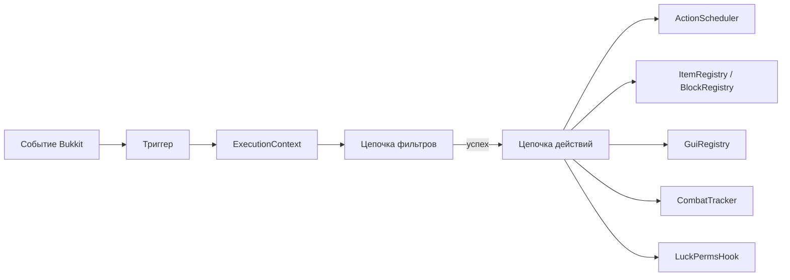

# 🏛️ Архитектура ядра ActionsAndTriggers (AAT)

## 1. Назначение и стек

**ActionsAndTriggers (AAT)** — плагин для Paper/Purpur, превращающий события Bukkit в декларативные пайплайны (триггер → фильтры → действия) и добавляющий виджетный GUI-движок для инвентарей, планировщик, кулдауны и боевой режим.

- Java 21, многомодульная сборка Gradle.
- Компиляция против `io.papermc.paper:paper-api:1.21.4-R0.1-SNAPSHOT` (Gradle-свойство `paperVersion`, по умолчанию 1.21.4). Релизные артефакты собираются против минимального поддерживаемого API; матрица компиляции дополнительно проверяет 1.21.5, 1.21.8 и 1.21.11.
- Только Bukkit/Paper API, без NMS.
- Опциональные мягкие зависимости: Oraxen, ItemsAdder, PlaceholderAPI, LuckPerms.

## 2. Структура модулей

| Модуль | Содержимое |
| :--- | :--- |
| `:aat-api` | Публичные контракты (`Action`, `Filter`, `Trigger`), реестры, `ActionTriggerAPI`, `ExecutionContext`/`CoreKeys`, `ActionScheduler`, `Registrar`, классы GUI и виджеты, интерфейсы провайдеров, `PapiHook`. |
| `:aat-core` | Точка входа `ActionsTriggers`, `AATParser`, `YamlTriggerLoader`, `YamlGuiLoader`, `GuiRegistry`/`GuiListener`, стандартные действия/фильтры/триггеры, `I18n`, `CombatTracker`, хуки, команды Lamp. Здесь же лежат пакеты `api.parser` и `api.provider.impl` (парсер и провайдеры Oraxen/ItemsAdder), поэтому API-jar не является полностью самостоятельным набором. |

Результаты сборки: `apiJar` (тонкий API-jar) и `shadowJar` (затенённый плагин, Lamp переносится в `kostin.ak.actionstriggers.libs.revxrsal`). Задача `deployToPlugins` копирует затенённый jar в жёстко зашитый локальный каталог сервера и входит в корневую задачу `build`.

## 3. Рантайм-пайплайн

1. `ActionsTriggers#onEnable` создаёт реестры и планировщик, вызывает `ActionTriggerAPI#init`, регистрирует стандартные действия, фильтры и триггеры, инициализирует хуки и команды, затем загружает `triggers/` и `guis/`.
2. Слушатель события, унаследованный от `BukkitEventTrigger`, делает быстрый выход (`TriggerRegistry#hasSubscriptions`) и только потом собирает `ExecutionContext` из объявленных экстракторов `ContextKey`.
3. `TriggerRegistry#dispatch` вызывает глобальные отладочные слушатели, затем каждую подписку, чей фильтр прошёл.
4. `YamlTriggerLoader` собирает для каждой записи скрипта колбэк, который выполняет распарсенные действия по порядку и останавливается при отмене контекста.
5. `BukkitEventTrigger` отменяет исходное событие, если контекст отменён и событие реализует `Cancellable`.

## 4. Контекст исполнения

`ExecutionContext` — контейнер типизированных значений на `ConcurrentHashMap` с флагом `cancelled`.

- Ключи — `ContextKey<T>`, сравниваются по `id` + `type`; чтение с другим типом возвращает `null`.
- `CoreKeys` определяет общие ключи: `PLAYER`, `LOCATION`, `BLOCK`, `BLOCK_MATERIAL`, `ENTITY`, `ITEM`, `ITEM_IN_HAND`, `ITEM_IN_HAND_ID`, `ITEM_ID`, `BLOCK_ID`, `CLICKED_BLOCK_ID`, `MESSAGE`, `DAMAGE`, `DAMAGE_CAUSE`, `DAMAGER`, `DAMAGE_SOURCE`, `ITEM_DROPS`, `KILLER`, `LEVEL`, `WORLD`, `WORLD_NAME`, `FROM_WORLD`, `TO_WORLD`, `HAS_BLOCK`, `IS_FLYING`, `ADVANCEMENT_KEY`, `ACTION`, `BUTTON_TYPE`.
- `clone()` делает независимую копию, которую планировщик использует для отложенной и периодической работы.
- Точный набор ключей каждого триггера — в `docs/ru/TRIGGERS_AND_ACTIONS.md`. Никакого `CANCEL_CONSUMER` нет: отмена — это флаг `cancelled`.

## 5. Подсистемы

### 5.1. Действия, фильтры и парсинг

- `ActionRegistry` и `FilterRegistry` сканируют классы на статические фабрики `@ConfigAction` / `@ConfigFilter` и кэшируют метаданные `@ActionParam` для `/aat list` и `/aat get params`.
- `AATParser` (в `:aat-core`) парсит отдельные действия, списки действий, условия, блоки `inject_context` и целые описания триггеров. `ParserOptions` задаёт допустимые ключи (`action`/`action_type`/`id`, `type`/`condition`/`id`, `trigger`/`event`/`type`, `inject_context`).
- Неизвестные ID действий или фильтров бросают `IllegalArgumentException` при загрузке; загрузчик логирует файл и переходит к следующему триггеру.

### 5.2. Планировщик и кулдауны

`ActionScheduler` оборачивает планировщик Bukkit: `runLater`, `runRepeating` (счётчик итераций в `{iteration}`), `runRepeatingTask`, именованные `scheduleNamed`/`cancelNamed` и кулдауны на игрока по ключу `UUID + key`.

Всё хранится в памяти. Именованные задачи и кулдауны теряются при перезапуске; `cancelAll()` существует, но плагин его в `onDisable` не вызывает (вызывается `Bukkit.getScheduler().cancelTasks(plugin)`).

### 5.3. Боевой режим

`CombatTracker` хранит для игрока метку времени истечения. `CombatListener` помечает атакующего и жертву на `EntityDamageByEntityEvent`, а также любого игрока на `EntityDamageEvent`, только в survival/adventure, с фиксированной длительностью 15 секунд.

В `config.yml` есть `combat.duration_seconds` и `combat.close_gui_on_damage`, но эти значения нигде не читаются: длительность — это дефолт конструктора 15, а при уроне принудительно закрывается только GUI с id ровно `astral_atlas` (хардкод в `CombatListener#checkAndCloseAtlas`).

### 5.4. Провайдеры предметов и блоков

`ItemRegistry` и `BlockRegistry` разрешают строки `<namespace>:<id>`. Ванильные предметы регистрируются всегда; провайдеры Oraxen и ItemsAdder — условно в `onEnable`.

Ванильного `BlockProvider` **нет**. `BlockRegistry#getFullId` откатывается к `minecraft:<material в нижнем регистре>`, поэтому ванильные ID блоков всё равно разрешаются, но `BlockRegistry#placeBlock` не умеет ставить ванильные блоки через провайдер.

### 5.5. GUI-движок

`GuiRegistry` хранит описания GUI по id, открывает инвентари с `AATGuiHolder`, рендерит виджеты в матрицу слотов и перерисовывает по запросу. `GuiListener` отменяет клики и драги по слотам без виджетов и возвращает предметы из слотов ввода/вывода на `InventoryCloseEvent`. Детали и ограничения — в `docs/ru/GUI_ENGINE.md`.

### 5.6. Локализация

`I18n` загружает `lang/messages_<language>.yml` в `ConcurrentHashMap`, поддерживает подстановку `{param}` и кэширует `Component`. Активный язык берётся из `config.yml` (`language`).

Локализация покрывает логи загрузчиков, сообщения боя и встроенных станков. Многие ответы команд, подсказки автодополнения, статусы станков и значения по умолчанию в действиях — жёстко зашитый русский/английский текст в `ActionCommand`, `AATTabCompleter`, `DefaultActionParsers` и `ProgressBarWidget`.

### 5.7. Команды и отладка

Lamp (`revxrsal.commands`) даёт `/aat` (алиас `/actionapi`) с подкомандами `run`, `trigger`, `debug`, `list`, `guis`, `get`, `reload`, `providers`, `provider_items`, `hand`, `search`, `open`. Право: `actionstriggers.admin`.

`/aat reload` перезагружает `config.yml`, языковой бандл, все триггеры (сначала отписывая этот плагин) и все GUI. Он, разумеется, не перезагружает classpath и не перерегистрирует действия/фильтры/провайдеры.

## 6. Жизненный цикл и поведение при сбоях

- `onDisable` останавливает фоновый таймер, отменяет задачи Bukkit этого плагина, очищает реестр скриптов, отписывает все триггеры и очищает реестр GUI.
- Открытые инвентари станков при выключении не обходятся, поэтому предметы внутри AAT при остановке не возвращает.
- Исключения в подписке или колбэке действия перехватываются `TriggerRegistry` и логируются; один сломанный скрипт не останавливает остальные.
- `ActionTriggerAPI` бросает исключение до вызова `init`, поэтому плагины, загружающиеся раньше AAT, должны отложить регистрацию.
